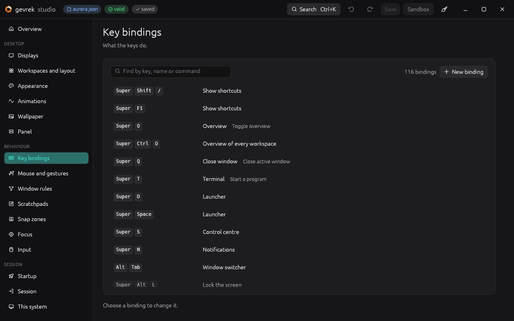

<p align="center">
  <picture>
    <source media="(prefers-color-scheme: dark)" srcset="assets/brand/logo/horizontal/gevrek-logo-horizontal-on-dark.svg">
    
  </picture>
</p>

<p align="center">
  <b>A tiling window manager and desktop shell for Windows and Linux.</b><br>
  One configuration, one set of keys, one look, on both.
</p>

<p align="center">
  <a href="https://ulaas.github.io/gevrek/">Website</a> ·
  <a href="#install">Install</a> ·
  <a href="#build">Build</a> ·
  <a href="docs/GUIDE.md">Guide</a> ·
  <a href="docs/LINUX.md">Linux</a> ·
  <a href="ARCHITECTURE.md">Architecture</a> ·
  <a href="LICENSE">MIT licence</a>
</p>

<p align="center">
  
</p>

gevrek arranges your windows for you: each gets its share of the display,
none lies over another, and you go between them, move them and gather them
on workspaces with a few keys. Around the windows it brings what a desktop
has: a panel, a launcher, a control centre, notifications, a lock screen,
and a settings program for all of it.

It is written in Rust, with [egui](https://github.com/emilk/egui) for
everything it draws and [Smithay](https://github.com/Smithay/smithay) under
its Wayland compositor.

> gevrek was developed fully with AI, with a hint of human taste.

## What is in it

**Windows that arrange themselves**

- Twelve layouts: dwindle, binary splits, main and stack, centred main,
  columns, rows, grid, spiral, a scrolling strip, monocle, an ultrawide
  stack, and plain floating
- Workspaces for each display, named or numbered, with keys to show one and
  to take a window along
- Tabs (several windows in one place), scratchpads, snap zones, pinned and
  floating windows, an overview of a workspace and of all of them
- Rules that say where a program's windows go and how they look
- Touchpad gestures, and the pointer for everything the keys do

**A shell around them** (`gevrek-shell`)

- A panel on every display: workspaces, the open windows, a tray, the
  clock, sound, network, battery
- A launcher that finds programs, gevrek's own commands and what you copied
- A control centre for sound, wireless, bluetooth, brightness, the night
  light and what is playing
- Notifications, on-screen displays for volume and brightness, a window
  switcher, a power menu
- On Linux also the lock screen, the wallpaper, screenshots and screen
  recording, the clipboard, and a display manager to sign in with

**One place to change it** (`gevrek-studio`)

- Every setting in a form, with search; nothing has to be written by hand
- Changes are tried first: applied for fifteen seconds and taken back unless
  you keep them, with undo for everything
- An automation graph: what gevrek does by itself when something happens,
  wired from node to node
- Built-in looks to start from, and live views of the windows, the events
  and the log

**And for the rest**

- `gevrek`, a command line that can do everything a key can, for scripts
- A welcome on the first start, and a tutorial that teaches gevrek on
  practice windows of its own

## Where it runs

| System | How gevrek runs there | State |
|---|---|---|
| Windows 10 and 11 | `gevrek-wm` arranges the windows of the Windows desktop; the shell replaces the taskbar | The most complete |
| Linux (Wayland) | `gevrek-wl` is the compositor itself, on the hardware or as a window in another session; X11 programs run through Xwayland | Tiling, workspaces, rules, keys, gestures, the shell, the studio and the command line work. See [docs/LINUX.md](docs/LINUX.md) |
| macOS (13 and later) | `gevrek-wm` arranges the windows of the macOS desktop through the Accessibility API | New: tiling, workspaces, focus, rules, keys (by the keyboard's layout), gestures, borders and tab strips work, and the shell's panel and launcher. The tray, what plays and pictures of windows are kept by macOS. See [packaging/macos/README.txt](packaging/macos/README.txt) |

The logic of arranging windows (`gevrek-engine`) knows nothing of the
system it runs on. Each system is a backend that implements the engine's
`Desktop` contract, so what is written once in the engine works on all of
them. [ARCHITECTURE.md](ARCHITECTURE.md) has the whole picture, and
[docs/CAPABILITY_MATRIX.md](docs/CAPABILITY_MATRIX.md) says which backend
offers what.

gevrek is at version 0.6 and young: expect rough edges, and keep the way
out in mind (`gevrek stop all` puts every window back).

## Install

Each [release](https://github.com/ulaas/gevrek/releases) has:

| System | File | |
|---|---|---|
| Windows 10 and 11 | `gevrek-windows-x64-setup.exe` | Installs for you alone, with no administrator. Or `gevrek-windows-x64.zip` and the `install.ps1` in it |
| Debian and Ubuntu (24.04 and later) | `gevrek-linux-x64.deb` | `sudo apt install ./gevrek-linux-x64.deb` |
| Fedora (44 and later) | `gevrek-linux-x64.rpm` | `sudo dnf install ./gevrek-linux-x64.rpm` |
| Other Linux | `gevrek-linux-x64.tar.gz` | The same files as a package places them, with a README |

On Linux gevrek is then in the login manager's list of sessions. On Windows,
`gevrek start all` starts it (see [First steps](#first-steps)).

**Updates.** On Windows an installed gevrek updates itself. Once a day, when
it starts, it asks GitHub for the newest release (nothing is sent but its
own version), gets a newer one ready, and installs it the next time it
starts, so a desktop in use is not interrupted. `gevrek update` installs it
at once, `gevrek update --check` only looks, and `gevrek update --automatic
off` turns the daily look off. The download is checked against the
release's SHA-256 list, and the build before is kept in the folder
`previous` beside the programs. On Linux the package manager updates: install
the newer package.

The programs are not signed, so Windows may ask before it runs the setup
program.

## Build

A current stable Rust toolchain is all Windows needs. The protobuf compiler
is built with the rest.

**Windows**

```powershell
cargo build --release --bins
cargo build --release -p gevrek-shell
cargo xtask install          # to ~/.local/bin; the build before is kept
gevrek start all
```

**macOS** (built as an application, so that the permission macOS asks for
is the application's and is kept from one build to the next)

```sh
packaging/macos/build-app.sh   # target/macos/Gevrek.app, signed
packaging/macos/install.sh     # to ~/Applications; gevrek in ~/.local/bin
gevrek start wm
```

**Linux** (the libraries first: [docs/LINUX.md](docs/LINUX.md) has the
package names)

```sh
cargo build --release -p gevrek-smithay -p gevrek -p gevrek-studio -p gevrek-shell --bins
scripts/run-nested.sh        # as a window inside the session you are in
```

## First steps

`gevrek start all` starts the window manager and the shell. The first time,
with no configuration of yours, your windows stay where they are and a
welcome opens: it lets you choose a layout, a look and where the panel is,
and offers the tour.

| | |
|---|---|
| `Super`+`D` | The launcher: a program, `>` a command, `:` what you copied |
| `Super`+`F1` | Every key, as your configuration has them |
| `Super`+`F2` | The tutorial |
| `Super`+`S` | The control centre |
| `Super`+`Q` | Close the window |
| `gevrek stop all` | Stop gevrek; every window is put back |

The settings program does not start with gevrek. Open it when you want to
change something: from the launcher's row of buttons, or with `gevrek start
editor`.

[docs/GUIDE.md](docs/GUIDE.md) goes on from here: the command line, the
configuration, the looks, gestures, and what only one system has.

## Checks

```sh
cargo xtask check
```

runs the tests and the lints for the system it is on. CI runs them on
Windows and on Linux for every push.

## The rest of the desktop

gevrek is the desktop. These are programs to use on it, by the same hands,
each a project of its own:

- [Soyuz](https://ulaas.github.io/soyuz/), a keyboard-first file explorer
- [gitem](https://ulaas.github.io/gitem/), a desktop Git client
- [Peek](https://ulaas.github.io/peek/), a remote desktop client for RDP and VNC
- [Corrent](https://ulaas.github.io/corrent/), a media server and player with a torrent client built in
- [walle](https://ulaas.github.io/walle/), for browsing, comparing and setting wallpapers

## Thanks

gevrek stands on the work of others, above all:

- [Smithay](https://github.com/Smithay/smithay), the Wayland compositor
  library under the Linux backend, and its client toolkit under the shell's
  surfaces
- [egui and eframe](https://github.com/emilk/egui), which draw every one of
  gevrek's programs
- [wgpu](https://github.com/gfx-rs/wgpu),
  [windows-rs](https://github.com/microsoft/windows-rs),
  [tonic](https://github.com/hyperium/tonic) and
  [Phosphor Icons](https://phosphoricons.com)

[THIRD-PARTY-NOTICES.md](THIRD-PARTY-NOTICES.md) lists every crate gevrek is
built with and its licence.

## Licence

MIT. See [LICENSE](LICENSE).
